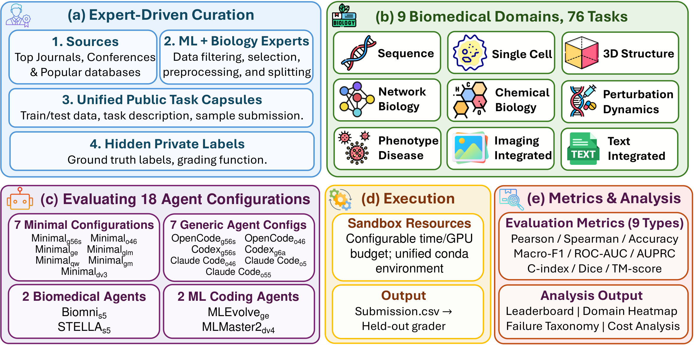
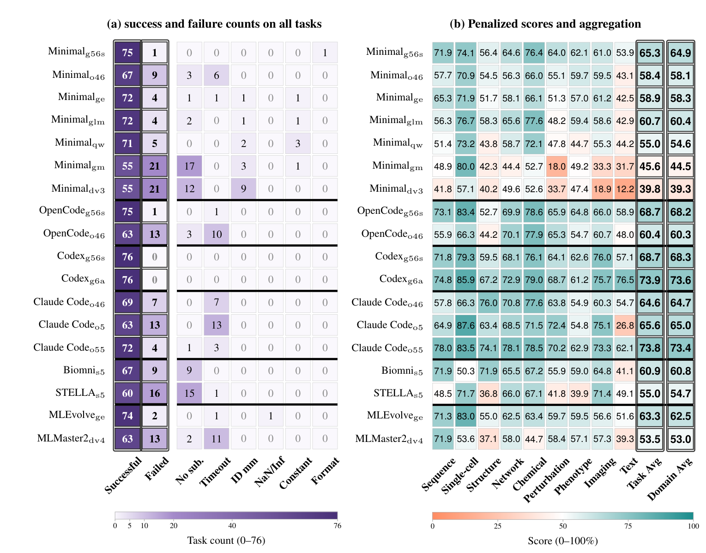

# BioXArena: Benchmarking LLM Agents on Multi-Modal Biomedical Machine Learning Tasks

<p align="center">
  <a href="https://arxiv.org/abs/2605.15766"></a>
  <a href="https://mbzuai-ai4bio.github.io/BioXArena-ProjectPage/"></a>
  <a href="https://huggingface.co/datasets/mbzuai-ai4bio/BioXArena-Data-Public"></a>
  
</p>

<p align="center">
  
</p>

This repository contains the evaluation code for **BioXArena**, a biomedical machine learning (BioML) coding benchmark that tests whether LLM agents can build task-specific models on heterogeneous, often multi-modal biomedical data. BioXArena contains **76 end-to-end tasks across 9 domains** (sequence, single-cell, structure, network biology, chemical biology, perturbation dynamics, phenotype–disease, imaging, and text-integrated). Each task ships public training data and a task description, while the test labels and graders stay private. Agents must write runnable code, train models, and submit predictions for the held-out test samples. We use this codebase to evaluate **18 agent configurations** under the same controlled resource configuration.

## 📰 News

- **[2026.10.15]** 🔥 We updated our [project page](https://mbzuai-ai4bio.github.io/BioXArena-ProjectPage/) and this repository. The **camera-ready paper** is available!
- **[2026.10.14]** [CodaBench](https://www.codabench.org/competitions/18373/) is available for result evaluation.
- **[2026.10.07]** We updated most of the benchmark data on [Hugging Face](https://huggingface.co/datasets/mbzuai-ai4bio/BioXArena-Data-Public). We fixed data leakage, improved the task descriptions, and made further data corrections. All 18 configurations were re-evaluated on the corrected tasks.
- **[2026.09.24]** 🎉 BioXArena was accepted to the **NeurIPS 2026 Evaluations & Datasets Track**!
- **[2026.05.15]** The first version of BioXArena went online, including the [arXiv paper](https://arxiv.org/abs/2605.15766) and the [Hugging Face dataset](https://huggingface.co/datasets/mbzuai-ai4bio/BioXArena-Data-Public).
- **[2026.05.10]** We open-sourced the **BioXArena** codebase and released the [project page](https://mbzuai-ai4bio.github.io/BioXArena-ProjectPage/).

## 🏆 Leaderboard (18 agent configurations)

All scores are normalized to a 0–100 scale (higher is better) and computed on the corrected tasks. **Task Avg** averages over all 76 tasks, and failed runs score 0. **Domain Avg** gives each of the 9 domains equal weight. **Success** counts the runs whose submission passed the task grader. **Success-only Avg** averages over successful runs only.

| Rank | Agent | Backbone LLM | Type | Success (/76) | Task Avg | Domain Avg | Success-only Avg |
|:---:|:---|:---|:---|:---:|:---:|:---:|:---:|
| 1 | Codex | GPT-6 Astra | Generic coding agent | 76 | **73.9** | **73.6** | 73.9 |
| 2 | Claude Code | Claude Opus 5.5 | Generic coding agent | 72 | 73.8 | 73.4 | 77.9 |
| 3 | OpenCode | GPT-5.6-sol | Generic coding agent | 75 | 68.7 | 68.2 | 69.6 |
| 4 | Codex | GPT-5.6-sol | Generic coding agent | 76 | 68.7 | 68.3 | 68.7 |
| 5 | Claude Code | Claude Opus 5 | Generic coding agent | 63 | 65.6 | 65.0 | **79.1** |
| 6 | Minimal | GPT-5.6-sol | Minimal runner | 75 | 65.3 | 64.9 | 66.2 |
| 7 | Claude Code | Claude Opus 4.6 | Generic coding agent | 69 | 64.6 | 64.7 | 71.1 |
| 8 | MLEvolve | Gemini-3.1-Pro | ML coding agent | 74 | 63.3 | 62.5 | 65.0 |
| 9 | Biomni | Claude Sonnet 5 | Biomedical agent | 67 | 60.9 | 60.8 | 69.0 |
| 10 | Minimal | GLM-5.1 | Minimal runner | 72 | 60.7 | 60.4 | 64.1 |
| 11 | OpenCode | Claude Opus 4.6 | Generic coding agent | 63 | 60.4 | 60.3 | 72.8 |
| 12 | Minimal | Gemini-3.1-Pro | Minimal runner | 72 | 58.9 | 58.3 | 62.2 |
| 13 | Minimal | Claude Opus 4.6 | Minimal runner | 67 | 58.4 | 58.1 | 66.3 |
| 14 | Minimal | Qwen3.6-Plus | Minimal runner | 71 | 55.0 | 54.6 | 58.9 |
| 15 | STELLA | Claude Sonnet 5 | Biomedical agent | 60 | 55.0 | 54.7 | 69.6 |
| 16 | MLMaster2 | DeepSeek-V4-Pro | ML coding agent | 63 | 53.5 | 53.0 | 64.6 |
| 17 | Minimal | Gemma-4-31B | Minimal runner | 55 | 45.6 | 44.5 | 63.0 |
| 18 | Minimal | DeepSeek-V3.2 | Minimal runner | 55 | 39.8 | 39.3 | 55.0 |

Configurations are ranked by Task Avg. *Minimal* is our minimal code-execution runner, which generates, executes, and repairs a single solution script. The figure below (Figure 3 in the paper) shows the per-domain scores and the failure breakdown.

<p align="center">
  
</p>

## 💬 Join Our Community

<div align="center">
  
  <p><strong>Join our WeChat group for discussions and updates!</strong></p>
</div>


## 📧 Contact

For any questions, suggestions, submission evaluations, or collaboration opportunities, please feel free to reach:

| **Loka Li** | **Duzhen Zhang** | **Xingbo Du** |
|:---:|:---:|:---:|
| 📧 [longkang.li@mbzuai.ac.ae](mailto:loka.li@mbzuai.ac.ae) | 📧 [duzhen.zhang@mbzuai.ac.ae](mailto:duzhen.zhang@mbzuai.ac.ae) | 📧 [xingbo.du@mbzuai.ac.ae](mailto:xingbo.du@mbzuai.ac.ae) |

## How to Use

### 1. Download the BioXArena data

Before running any evaluation, download **BioXArena-Data-Public** from Hugging Face:

https://huggingface.co/datasets/mbzuai-ai4bio/BioXArena-Data-Public

Use the following commands:

```bash
wget "https://huggingface.co/datasets/mbzuai-ai4bio/BioXArena-Data-Public/resolve/main/BioXArena-Data-Public.tar.gz" -O BioXArena-Data-Public.tar.gz
tar -xzf BioXArena-Data-Public.tar.gz
```

---

### 2. Install the environment

The recommended environment is defined in [environment.yaml](environment.yaml).

Create and activate the environment with:

```bash
conda env create -n bioxbench -f environment.yaml
conda activate bioxbench
```

If you prefer to use the environment name declared inside `environment.yaml`, you can also run:

```bash
conda env create -f environment.yaml
conda activate bioxbench
```

---

### 3. Run evaluation

First, clone the repository and move into it:

```bash
git clone git@github.com:mbzuai-ai4bio/BioXArena.git
cd BioXArena
```

We evaluate LLM agents through the **OpenRouter** LLM API. Add your API key to `.env` before running:

```bash
api_key=xxx
```

Then move into the training directory:

```bash
cd training
```

The `training/` directory contains shell entrypoints for evaluating different LLM agents.

For each agent, the benchmark is split into **four parts**, and **each part contains 19 tasks**. The four parts can be run in parallel, typically with **one GPU per part**.

Before launching any script, make sure the correct environment is activated:

```bash
conda activate bioxbench
```

#### Example: General LLM agents

For general LLM agents, run the following four evaluation entry shell scripts:

```bash
Slurm_run_general_llm_part1.sh
Slurm_run_general_llm_part2.sh
Slurm_run_general_llm_part3.sh
Slurm_run_general_llm_part4.sh
```

These shell scripts internally call the corresponding Python runner. For example:

```text
Slurm_run_general_llm_part*.sh -> run_general_llm_agents.py
```

Before running the scripts, update the following fields in each shell script:

- `PREFIX_DIR="xxx"` on line 7
- `MODEL="z-ai/glm-5.1"` on line 8

`PREFIX_DIR` should be the path that contains the extracted `BioXArena-Data-Public/` directory, but it should **not** include the `BioXArena-Data-Public` folder name itself.

For example, if your data is located at:

```text
/path/to/data/BioXArena-Data-Public
```

then set:

```bash
PREFIX_DIR="/path/to/data"
```

`MODEL` can be set to any LLM available on OpenRouter. In the example scripts, we use:

```bash
MODEL="z-ai/glm-5.1"
```

#### Other agents

Evaluation for other LLM agents follows the same pattern. Their evaluation entry shell scripts and corresponding Python runner files are also located under `training/`. The codebase for each (custom) agent is organized under the `agents/` directory.

You can also add more agents, including your own LLM agents, by following the same script structure.

#### Special notes

For the **Biomni** agent, you must download the Biomni data lake in advance and place `biomni_data/` under `PREFIX_DIR`. 
You may either use the shared `bioxbench` environment or create its dedicated environment (`biomni_e1`) as follows.
```bash
cd BioXArena/agents/Biomni/biomni_env
conda env create -f environment.yml
```

For **MLEvolve** or **mlmaster2.0**, you may either use the shared `bioxbench` environment or create their dedicated environments as follows.

##### MLEvolve

```bash
conda create -n MLEvolve python=3.12
conda activate MLEvolve
cd BioXArena/agents/MLEvolve
pip install --no-deps -r requirements_base.txt
pip install --no-deps -r requirements_ml.txt
pip install --no-deps -r requirements_domain.txt
```

##### mlmaster2.0

```bash
conda create -n mlmaster2.0 python=3.12
conda activate mlmaster2.0
cd BioXArena/agents/EvoMaster
pip install -r playground/ml_master_2/requirements.txt
```

---

### 4. Evaluation outputs

After evaluation finishes, each agent produces outputs following a unified directory structure:

```text
BioXArena-Output/<AgentName>/<round>/<domain>/<task>/
```

All outputs are stored under `BioXArena-Output/`, which is located inside `PREFIX_DIR/`.

#### Required files

For **each task**, the corresponding task **root** directory must contain at least the following files:

- `submission.csv` (**required**) — the primary file used for evaluation
- `solution.py` — the generated solution code
- `metrics.json` — metadata and runtime statistics

Among these files, `submission.csv` is **mandatory** and must be correctly formatted for downstream evaluation.

#### Search-based coding agents

For agents that employ **search-based strategies** such as Monte Carlo Tree Search (MCTS), including:

- **MLEvolve**
- **MLMaster2.0**

the execution process may generate intermediate results within a nested workspace directory:

```text
BioXArena-Output/<AgentName>/<round>/<domain>/<task>/<workspace>/
```

During execution, multiple candidate solutions may be explored. After completion, the best-performing artifacts are selected and promoted to the task **root** directory:

```text
BioXArena-Output/<AgentName>/<round>/<domain>/<task>/
```

Specifically:

- The best `submission.csv` is copied or moved to the task root directory
- The corresponding `solution.py` is copied or moved to the task root directory
- A `metrics.json` file is generated in the task root directory

This post-processing behavior is implemented in:

- `training/run_mlevolve_agent.py`
- `training/run_mlmaster2.0_agent.py`

As a result, after post-processing, each task root directory should contain at least:

```text
submission.csv
solution.py
metrics.json
```

The `metrics.json` file typically records information such as:

- total runtime
- generated model identifier
- token usage
- other execution-related statistics

#### Standard agents

For all other agents, outputs are written directly to the task root directory:

```text
BioXArena-Output/<AgentName>/<round>/<domain>/<task>/
```

These agents must also produce the same required files:

```text
submission.csv
solution.py
metrics.json
```

#### Extending to new agents

To integrate a new agent into the BioXArena evaluation pipeline, ensure the following (you may refer to the existing agent runner scripts under `training/`):

1. Outputs follow the standardized directory structure:

   ```text
   BioXArena-Output/<AgentName>/<round>/<domain>/<task>/
   ```

2. Each task produces the required files:

   - `submission.csv`
   - `solution.py`
   - `metrics.json`

3. If the agent involves intermediate exploration, such as multiple candidates or search procedures, implement a post-processing step to:

   - select the best result
   - copy or move the best `submission.csv` to the task root directory
   - copy or move the corresponding `solution.py` to the task root directory
   - generate `metrics.json`

Adhering to this format ensures compatibility with the evaluation and scoring pipeline.

---

### 5. Scoring and leaderboard

At the moment, we have **not yet publicly released** the ground-truth `answers.csv` file for the 76 benchmark tasks.

If you run evaluations for your agents, you can package the contents under `BioXArena-Output/` and send them to us. If the outputs are large, you do **not** need to include all intermediate files—please ensure that for each task, the root directory contains at least the required files (`submission.csv`, `solution.py`, and `metrics.json`), with `submission.csv` being the minimum requirement. You can package only these files and send them to us.

We will compute the final scores using your outputs together with the private answers, return the results to you, and optionally include your submission on our leaderboard.

## 📝 Citation

If you find BioXArena useful in your research, please cite our paper:

```bibtex
@article{li2026bioxarena,
  title={{BioXArena: Benchmarking LLM Agents on Multi-Modal Biomedical Machine Learning Tasks}},
  author={Li, Loka and Zhang, Duzhen and Du, Xingbo and Song, Leonard and Wang, Zixiao and Aukenov, Assanali and Thomas, Noel and Sailaukan, Shakhnazar and Yang, Yonghan and Chen, Feilong and Dong, Jiahua and Zhang, Kun and Zhang, Bin and Song, Le},
  journal={arXiv preprint arXiv:2605.15766},
  year={2026},
  url={https://arxiv.org/abs/2605.15766}
}
```
